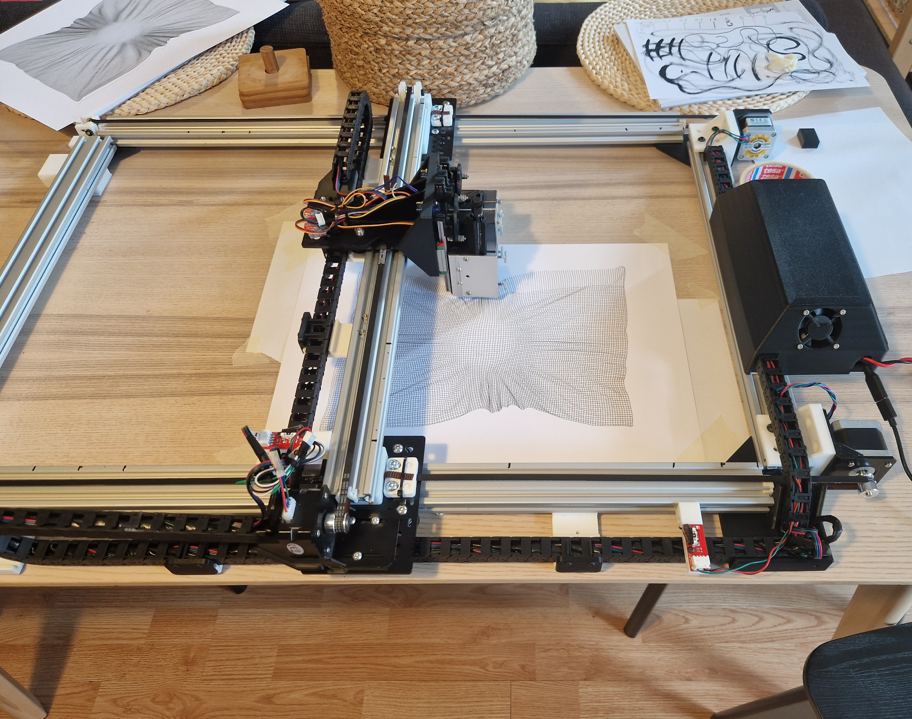
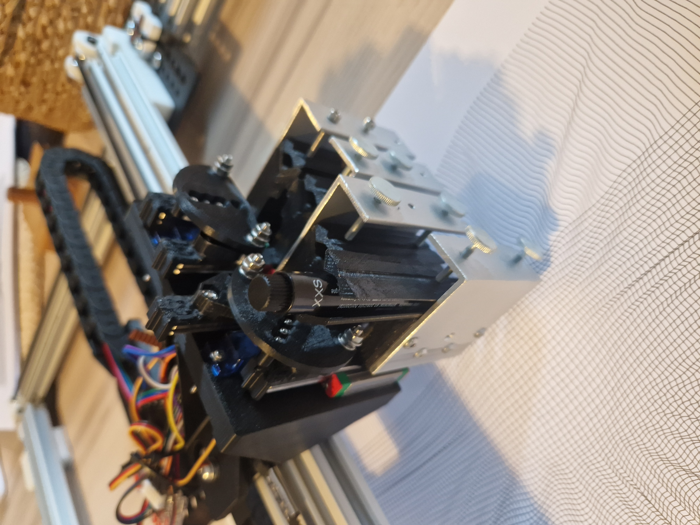

# A1 Pen Plotter

A large-format (A1) pen plotter that I designed and built from scratch, running Klipper on a Raspberry Pi, with Grasshopper tools that turn curves into G-code for generative art. This repository contains the most important parts needed to understand and reproduce it: CAD files for the 3D-printed parts, the Klipper and Raspberry Pi configuration, test plots, and my Grasshopper objects.

Work made with this plotter from my *Forms* series of prints was shown at the Woolwich Contemporary Print Fair 2025.

## Overview

I wanted a plotter big enough to make gallery-scale generative drawings while having a thin enough profile to be easily stored away. Nothing on the market existed with this in mind (at least within my meagre budget) so I designed this machine in CAD, 3D printed the custom parts, and adapted Klipper, which is normally used for 3D printers, for 2.5D pen plotting: movement in X and Y, with a tool holder that can hold up to 4 tools as a time and lift and lower between strokes using only two servos.

**Highlights**
- Plot area up to A1 ([594 x 841 mm])
- Custom CAD-designed, 3D-printed parts
- Klipper motion control on a Raspberry Pi, modified for 2.5D pen plotting
- Controlled over the network from a computer
- Grasshopper tools for converting curves to G-code and ordering strokes to reduce drawing time
- Test plots for calibration (for example, skew)

## Repository contents

| Folder | Contents |
|---|---|
| `Plotter/CAD/` | STL files for the 3D-printed parts |
| `Plotter/Klipper_Mainsail/` | Klipper configuration and test GCode |
| `Rhino Grasshopper/` | Grasshopper definitions and user objects for generating plotter GCode |
| `Media/` | Photos and videos of the plotter and prints |

## Hardware

I've not included a full BOM here as components were slowly obtained over the years. I leave it up to the curious and commited to source your own parts and do your own CAD to fit. 

| Part | Details |
|---|---|
| Frame / motion | I used 20x40 aluminium V-Slot extrusion |
| Motors and drivers | NEMA 17 steppers, timing belts and pulleys |
| Control board | BigTreeTech SKR mini E3 v3.0 |
| Computer | Raspberry Pi 4 |
| Toolhead and Pen holder | Custom 3D-printed pen lift mechanism with 2 small servo motors |
| Other | Power supply, endstops, custom printed brackets and mounts, etc.|

The most important 3D-printed parts are in [`Plotter/CAD/`]. Most of the parts were designed in Onshape.

## Software and control

The plotter runs [Klipper](https://www.klipper3d.org/) on a Raspberry Pi. Klipper is designed for 3D printers, so I configured it for pen plotting with macros to control servos for pen lifting and lowering. GCode (utilising these macros) is generated with my Grasshopper definitions and User Objects. The plotter is operated from a computer over the network (Mainsail).

The most important files in `Plotter/Klipper_Mainsail/` are the Klipper printer configuration files.

You will need to adjust pin mappings and machine dimensions for your own hardware. I trust anyone copying my setup knows what they are doing.

# Art - Plotform

You can find me on Instagram [@plotform.art](https://www.instagram.com/plotform.art/)

## My process

1. **Design:** once I have a concept and composition and have decided on materials, colours and tools, I create drawings in Grasshopper (Rhino) using a combination of generative techniques, simulation and manual drawing and manipulation. I like to think of my process as a hacker-esque collaboration of human and machine with **absolutely no AI at any stage**.
2. **Convert to G-code:** my user objects turn curves into G-code for the plotter, handling pen up and down moves while also optimising plot order. Sometimes my art stays in the digital realm (e.g. animations), but more often than not I like to realise it into something physical.
3. **Plot:** set-up each print and send G-code to the plotter. Usually ink on paper but can vary. For limited editions, I delete all GCode and Rhino/Grasshopper files once all editions are made as a guarentee they will forever be limited.

**Requirements:** Rhino 8, I try to keep to vanilla Grasshopper components or very common plugins.

## About Me

Built by Dr Michael Joyce - [LinkedIn](https://www.linkedin.com/in/michael-joyce-badea)

PhD in mathematics (computational geometry and simulation). Six years experience working in architecture firms and print research lab making tools for artists and architects. I mainly work on robotics, simulation and digital fabrication. Co-founder of [Advanced Clay Tooling](https://advancedclay.com/).
